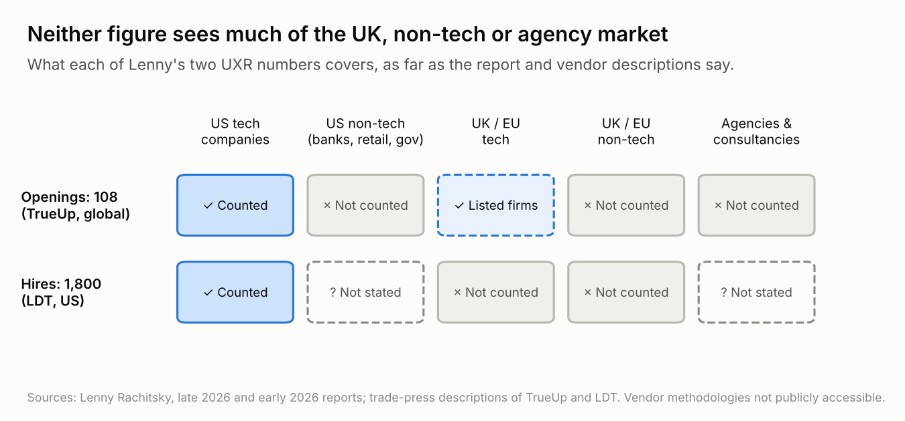
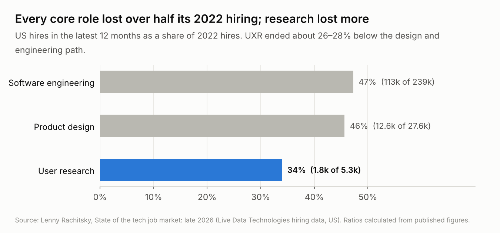
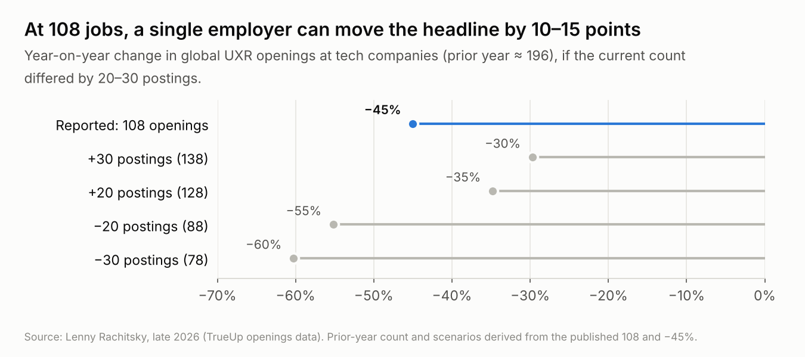
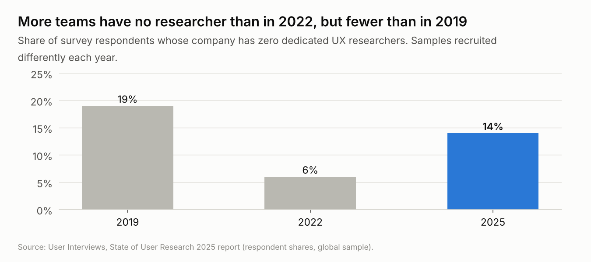
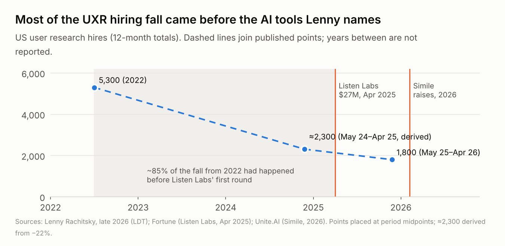

# Lenny's UXR collapse is real but mismeasured

Lenny Rachitsky's late-2026 figures are credible evidence of one thing: **user researcher hiring at US and tech-sector employers has fallen steeply since 2022**. His two data sources, hires and openings, both point down, and independent surveys and US job-board data agree on the direction. The figures say much less about how far the profession has fallen. The baseline is a peak year (2022). Neither vendor publishes which job titles count as "UX research" or which employers are included. The openings figure deliberately excludes the non-tech sectors where much UK research work happens. The hiring data appears to come largely from public professional profiles, which update late and get rewritten after the fact. Lenny's own figures also show that engineering hires (−53%) and product design hires (−54%) fell almost as far as UXR hires (−66%). That leaves roughly 12–13 percentage points that need a research-specific explanation, not the full two-thirds. In relative terms, UXR hiring ended about a quarter below the path design and engineering followed, so the research-specific part is real but much smaller than −66% implies. His explanations (faster shipping, AI tools such as Listen Labs and Simile, possible "extinction") are framed as theory, and the report offers no data for any of them. Both named tools also raised their major funding after most of the decline had already happened, which rules them out as the main cause, though not AI tooling in general. The researchers who replied, the uxroh post among them, are right about the baseline, scope and title problems. The wider evidence makes some of those points stronger and complicates others. Whether the function shrank mainly through layoffs or through roles not being refilled, the available data cannot say. The fair reading is a smaller, more senior function whose work is partly moving to other job titles, not a function going extinct.

## Two datasets, two units, one undisclosed definition

Lenny's UXR paragraph combines two different measures. The first is **Live Data Technologies (LDT) hiring data**: about 1,800 US user researchers hired over the past year, down 66% from 5,300 in 2022. Lenny calls this "the steepest drop of any role we looked at", and says hiring fell a further 22% on the year before. He adds that Meta and Google made about one in eight US UXR hires in 2025, and that so far in 2026 Google is the only company to have hired 50 or more. The second is **TrueUp openings data**: 108 open UXR jobs at tech companies globally, with UX research openings down 45% over the year ([Lenny](https://lennysnewsletter.com/p/state-of-the-tech-job-market-late)).

These are different kinds of number. The 108 is a **stock**: global job postings live on one day at a curated set of tech employers. The 1,800 is a **flow**: US hires over twelve months (May 2025 to April 2026), at employers the report does not define. TrueUp is described as scanning openings at "Big Tech companies and 'top' startups" ([The Pragmatic Engineer](https://newsletter.pragmaticengineer.com/p/state-of-eng-market-2024?open=false)). Lenny's March 2026 report says it **excludes non-tech companies and consulting agencies** ([Lenny, early 2026](https://www.lennysnewsletter.com/i/191595250/4-design-roles-have-plateaued)). LDT works differently. It builds employment histories for a panel of mostly white-collar professionals by "prompt-engineering" search engines to read public web information ([Pacific Business Times](https://www.pacbiztimes.com/2024/08/07/live-data-keeps-real-time-information-on-employment-status/)). Its panel has grown from about 70 million people to the **124 million** cited in the report. A "hire" in LDT's framework is most likely a detected change of employer. Its affiliated newsletter counts company changes and internal title changes separately ([Human Capitalist](https://humancapitalist.substack.com/p/100b-walks-out-the-door)). So a designer retitled as a researcher inside the same company probably does not count as a UXR hire.

The report never says which job titles count as user research in either dataset. That matters, because grouping rules have already moved these numbers sharply. A footnote admits the design category shrank from about 5,000 to about 2,000 openings between reports because illustrators, creative directors and brand designers were removed ([Lenny](https://lennysnewsletter.com/p/state-of-the-tech-job-market-late)). The March 2026 report published a **PM-to-design openings ratio of 1.27**, against about 5,700 design roles ([Lenny, early 2026](https://www.lennysnewsletter.com/i/191595250/4-design-roles-have-plateaued)). The November report says that ratio was "2.6 earlier this year." That restatement follows from the disclosed regrouping: on the research team's arithmetic, PM openings come out at roughly 7,200–7,300 under both versions, and the narrower design definition shrinks the March design count to roughly 2,800. It is one redefinition, not two. But the footnote discusses only absolute design counts. It does not flag that the restated ratios also erase the March report's finding that PM openings overtook design only in mid-2023. In that sense the historical series was quietly recalculated backwards. Nobody outside the vendors can tell whether "product researcher", "design researcher", "quantitative UX researcher", "research scientist" or "insights manager" count towards the 108 and the 1,800. At a base of 108, moving one title family in or out could change the result by tens of per cent.

A caveat applies to everything in this section. **Neither vendor's methodology could be read first-hand.** trueup.io returned errors, and livedatatechnologies.com was not reachable in this research. Everything known about their coverage, title rules and hire detection comes from Lenny's posts, trade press, an affiliated newsletter and a competitor's review.

## Peak baselines, profile lag and small bases distort the magnitude

**The 2022 baseline is the biggest single distortion.** Lenny's own series calls 2022 the "peak" for engineering. Independent data suggests UXR had its own bubble then. Dovetail, citing Indeed Design data, reports that UX researcher postings **rose 566%**, against 265% for designers ([Dovetail, citing Indeed](https://dovetail.com/outlier/responding-to-the-reckoning/)). Dovetail does not state the measurement window, though its surrounding text places the surge in 2020–21. Lawton Pybus analysed 21,639 Indeed UXR postings from June 2021 to September 2022 and found openings **peaked in February 2022** within that window ([UX Collective](https://uxdesign.cc/the-ups-and-downs-of-the-uxr-job-market-9798bebaaa70)). His data shows 2022 was at least a local peak; it does not reach back to pre-boom levels. A decline measured from the top of a boom mixes a return to normal with structural loss, and the report cannot separate the two. Lenny has reportedly acknowledged part of this. In a reply in his comments, as paraphrased in the uxroh post, he said the openings data cannot go back before 2023 with his source, and that LDT holds earlier hiring history he will try to use next time ([uxroh](https://uxroh.substack.com/p/reading-lennys-job-market-data-as)). LDT reportedly describes its method as unchanged since 2019 ([Lena Kul](https://lenakul.substack.com/p/i-like-lenny-but-his-2026-job-market)), so a pre-boom baseline should be technically possible.

**Profile lag probably makes the latest year look worse than it is.** LDT describes its source as public web information; the research notes judge that this is likely to be mainly public professional profiles, but LinkedIn is not confirmed as the source. Data built from professional profiles undercounts recent moves because people update their profiles late. Revelio Labs, a comparable vendor, runs a "nowcasting" model specifically to fill this gap, and notes the delay is worse after layoffs ([Revelio Labs](https://www.data-dictionary.reveliolabs.com/methodology.html)). LDT reportedly re-checks its sources roughly every ten days ([Signalbase](https://www.trysignalbase.com/best-job-change-tracking-tools)). That only measures how often LDT looks, not how quickly people post a change. Lenny's window ends about six and a half months before publication, which helps. But the −22% year-on-year figure still compares a less complete recent year with a more complete earlier one, and that bias makes the decline look steeper. The 2026 claim about Google relies on the newest, least complete data. Profiles also get rewritten after the fact. An NBER study of LinkedIn profile snapshots taken over time found **19.7% of established US users later edit the title or description of a job they have already left** ([NBER](https://www.nber.org/index%2ephp/papers/w35546)). Revelio puts the figure for tech workers at **nearly one in three** ([Revelio Labs](https://www.reveliolabs.com/blog/linkedin-profile-edits-research)). Both findings come from comparable LinkedIn-derived data; applying them to LDT is the research team's inference. If they carry over, the 2022 figure of 5,300 is not fixed either. It changes as people relabel their past jobs, for example when a former "UX researcher" now presents as a "product strategist".

**The base is small enough that a few employers can move it.** The following arithmetic is the research team's own, not Lenny's. A 45% fall to 108 implies about 196 openings a year earlier, so the drop is **about 88 postings worldwide**. One large employer opening or freezing 20–30 requisitions would change the count by about a fifth to a quarter, and move the −45% by roughly 10–15 points (to about −35% or −30% if added, or about −55% or −60% if removed). Concentration adds to this. If Meta and Google really made one in eight US hires in 2025, a few firms' budget decisions matter, though the data does not show how much of the decline they drove. That may be partly a story about Big Tech budgets, not necessarily a change in how research is practised across industry.

The report's own comparisons also blunt the "steepest drop" framing. On Lenny's figures, US software engineering hires fell from 239,000 to 113,000 (−53%), product design hires from 27,600 to 12,600 (−54%), and UXR hires from 5,300 to 1,800 (−66%) ([Lenny](https://lennysnewsletter.com/p/state-of-the-tech-job-market-late)). "Steepest" is literally true, but UXR sits inside the same post-boom correction as every other product role. A ratio view gives the research-specific gap more weight than the point difference suggests. UXR kept about 34% of its 2022 hires, against about 46–47% for design and engineering, so it ended roughly 26–28% below the path those roles followed (research team's arithmetic). On either view, roughly a fifth to a quarter of UXR's fall looks research-specific and the rest is shared. A smaller population is also expected to swing further. The report's own logic contains one point in Lenny's favour. For PM and engineering, openings rose while hires fell, and he reads that gap as a sign that "landing great PMs is getting harder", and great engineers too. For UXR, openings and hires both fell. Two independently collected measures agree on direction, which makes a real decline more believable, not less.

## Independent evidence confirms the direction, not the collapse

Practitioner surveys show continuing layoffs rather than a single cliff, but they cannot settle how hard UXR was hit. In User Interviews' 2025 State of User Research report (485 respondents), **21% of respondents said their company had laid off UX researchers**, essentially the same as 22% the year before. In its breakdown by function, UXR sat slightly below Product/UX design (26%), engineering (24%) and product management (21%), and near the 20% average across departments ([User Interviews](https://www.userinterviews.com/state-of-user-research-2025-report)). This is an incidence measure: the share of respondents whose company laid off anyone in that function, not the share of staff who lost their jobs. It is biased towards larger departments, which are more likely to record at least one layoff, so UXR roughly matching much larger design and engineering teams does not show that researchers were safer, and could mean the reverse. It also covers 2025 only, after most of the hiring decline. Wider UX data is harsher. MeasuringU and UXPA, as cited in a User Interviews job-market guide, found that 35% of organisations reduced UX staff (all UX roles, not only research), about twice recent rates; the guide does not state the year explicitly, though its link implies 2025 ([User Interviews](https://www.userinterviews.com/blog/user-research-job-market-guide)). User Interviews reported that headcount and team sizes stayed consistent, with some movement around the margins. Asked whether there are now fewer researchers, it answered "Possibly". Sentiment, though, collapsed. **49% were negative about UXR's future, up 26 points**, and 67% rated career opportunities negatively. The respondent pool also shrank 36% and skewed senior, which may reflect a smaller field, though it could also reflect recruitment. The 2019, 2022 and 2025 samples were recruited differently, so comparisons across years are rough. Surveys of people still working in research cannot count the people who left. Steady team metrics among those who remain can coexist with a steep fall in new hires.

Put the two together and a mechanism is tempting, but it cannot be tested here. Lenny counts hires, so a fall in hires is by definition a fall in filled requisitions; it says nothing on its own about whether existing researchers were laid off. One hypothesis is that the function shrank mainly by not replacing people, which would fit the move towards senior staff. The survey data cannot test that against the alternative of disproportionate layoffs, and the incidence measure above does not rule the alternative out. NN/g's State of UX 2026 is consistent with the timeline. It describes a sharp drop around 2023 continuing into 2024, then uneven stabilisation from late 2024, with **senior and generalist roles recovering faster than entry-level ones** ([NN/g](https://www.nngroup.com/articles/state-of-ux-2026/)).

Longer-run data is less dramatic still. The share of respondents reporting zero dedicated UXRs at their company rose from 6% in 2022 to about 14% in 2025, but **remains below its 2019 level of 19%** ([User Interviews](https://www.userinterviews.com/state-of-user-research-2025-report)). Against a pre-boom baseline, the decline looks more like a reset than an extinction, with the caveat that the samples differ across years. That is not proof all is well. A team survey measures whether respondents' organisations still employ researchers, not how many.

UK data is thin, and it runs against Lenny's direction. IT Jobs Watch recorded **128 UK permanent ads mentioning "UX Research" in the six months to 14 November 2026**, against 59 a year earlier. The median salary rose 17.5% to £60,500. However, UXR's share of all IT ads was flat at 0.10–0.11% and its rank fell, so the rise in count mostly reflects more ads overall, not stronger relative demand ([IT Jobs Watch](https://www.itjobswatch.co.uk/jobs/uk/ux%20research.do)). More telling for a UK fintech reader: ads with the "User Experience Researcher" title carry tags for **Digital Banking, Fintech and Wealth Management** ([IT Jobs Watch](https://www.itjobswatch.co.uk/jobs/uk/user%20experience%20researcher.do)). UK government also treats user researcher as a formal profession in its DDaT Capability Framework, updated in January 2025 according to the research notes ([DDaT framework](https://ddat-capability-framework.service.gov.uk/user-researcher.html)). That page now redirects to another government site and could not be re-checked. Banks, wealth managers and government digital teams sit largely outside TrueUp's stated universe. LDT's hiring data is US-only, so it does not reach them at all. Neither the US nor the UK publishes an official occupation series for user researchers. BLS folds them into broad categories such as market research analysts ([BLS](https://www.bls.gov/ooh/business-and-financial/market-research-analysts.htm)), so no official benchmark exists.

High-end demand also persists at the AI labs. Anthropic advertised a "User Experience Researcher, Platform" role in September 2026 at **US$305k–385k** ([General Catalyst job board](https://jobs.generalcatalyst.com/companies/anthropic/jobs/92605799-user-experience-researcher-platform)). OpenAI has advertised quantitative, mixed-methods and senior UXR roles ([Stripes job board](https://jobs.stripes.co/companies/openai/jobs/67241166-quantitative-ux-researcher)). These are anecdotes, not counts, but they fit the picture of a smaller, more senior, more technical function, not a dying one.

## The causal story arrives after most of the decline

Lenny frames his explanation as opinion: "My theory is that the increasing pace of product development is responsible." Teams are "releasing products earlier" and "learning and iterating post-launch". Tools such as Listen Labs and Simile let "non-UXR people … do user research themselves". He ends with "I wonder if UXR as a dedicated function is going extinct" ([Lenny](https://lennysnewsletter.com/p/state-of-the-tech-job-market-late)). The hedging is honest. But the report contains **no measure of release speed, tool adoption or who now runs research**, so none of these explanations is tested.

Timing is the strongest objection to the two named tools as the cause. Listen Labs raised its first $27M, led by Sequoia, in **April 2025** ([Fortune](https://fortune.com/article/ai-startup-listen-labs-sequoia-27-million-funding/)), and its $69M Series B in January 2026 ([VentureBeat](https://venturebeat.com/technology/listen-labs-raises-usd69m-after-viral-billboard-hiring-stunt-to-scale-ai)). Simile's $100M Series A and its Series B of more than $200M came in **2026** ([Unite.AI](https://www.unite.ai/simile-raises-more-than-200-million-at-a-2-billion-valuation-to-scale-human-behavior-simulations/)). Most of the fall from 5,300 hires happened in 2023–24, before either tool operated at scale. At most they could contribute to the latest year's −22%. That rules out the named examples, not AI tooling in general. General-purpose LLMs such as ChatGPT were available from late 2022, and nothing here tests their effect. Tsirlin's counter-argument, known only second-hand through the uxroh summary, is that LLMs entered everyday workflows only after the decline began.

The two tools also do different things, and neither obviously replaces in-house UXR. Listen Labs runs AI-moderated interviews with **real participants**. Its founders said their own interviews showed the ideal buyer was **marketing, not product managers** ([Fortune](https://fortune.com/article/ai-startup-listen-labs-sequoia-27-million-funding/)). Simile simulates people. Its headline accuracy figure is that agents reached **85% of participants' own two-week test–retest consistency**, which is a relative benchmark, not 85% accuracy. Its named customers (CVS Health, Gallup, Deloitte, Wealthfront) lean towards market and consumer research ([Unite.AI](https://www.unite.ai/simile-raises-more-than-200-million-at-a-2-billion-valuation-to-scale-human-behavior-simulations/)). Both may compete more with market research budgets than with UXR headcount. Independent evidence on synthetic users is consistently cautious. NN/g found synthetic users over-reported good behaviour, gave sycophantic responses to concepts, and should supplement, never replace, real research ([NN/g](https://nngroup.com/articles/synthetic-users/)). MeasuringU reviewed 12 peer-reviewed studies and found high correlations but shifted means and **compressed variance**. It concluded that synthetic users can give directional signals but are often imprecise ([MeasuringU](https://measuringu.com/review-of-experiments-with-synthetic-users/)).

The best alternative explanation is older and appeared on Lenny's own platform. In early 2024, Judd Antin argued on Lenny's Podcast that much research was "middle-range": interesting but not tied to business impact, which made it an easy cut ([Lenny's Newsletter](https://www.lennysnewsletter.com/p/the-ux-research-reckoning-is-here)). NN/g adds the macro context. Higher interest rates pushed leaders towards roles with simple, direct ROI, and "AI will replace researchers" was a **convenient narrative in a cost-cutting environment** ([NN/g](https://www.nngroup.com/articles/state-of-ux-2026/)). Together with the end of zero-interest-rate overhiring and with retitling, these explanations fit the timing far better than 2025-era tools do, though they are also untested here.

On the question of conflicts of interest, this research found **no evidence** that Lenny invests in, advises or is sponsored by Listen Labs or Simile. His angel portfolio is not public, so "not found" is the limit of that claim ([NFX Signal](https://signal.nfx.com/investors/lenny-rachitsky)). The clearer issue is structural, and he discloses it. TrueUp powers Lenny's Jobs, the post promotes both data partners, and his audience and sponsors are PMs and AI tool companies ([Lenny](https://lennysnewsletter.com/p/state-of-the-tech-job-market-late)). A "PMs win, specialists get automated" story suits that business. That does not make it wrong, but it is a reason to ask for evidence.

## Researchers' replies converge on baseline, scope and titles

The researchers who replied share a fairly consistent set of objections. Hughes's post treats Lenny's UXR claims as a hypothesis, not a finding ([uxroh](https://uxroh.substack.com/p/reading-lennys-job-market-data-as)). It argues that the data cannot distinguish a reset from a decline, cannot show its coverage, and cannot show who now does research. Inna Tsirlin (Head of YouTube Shopping UXR), as summarised in the same post, used **Indeed postings for 2018–2025 across all US industries**. She argued that tech postings peaked in Q1 2022 and had returned to their 2018 baseline by the end of 2025, with UXR, design and engineering moving together, and that LLMs entered everyday workflows only after the decline began. Lena Kul, a retired design recruiter, questioned TrueUp's "tech and tech-ish" definition and the transparency of LDT's web scraping. She added that only 1 of her 17 recent client roles was ever posted publicly ([Lena Kul](https://lenakul.substack.com/p/i-like-lenny-but-his-2026-job-market)). Her piece leans on ChatGPT-generated layoff figures, which weakens it. Supporting voices are scarce. A design generalist commenting on the uxroh post argued that researchers too often defend process instead of adapting. The other supportive material comes from AI-research vendors that published before the report.

The wider evidence **strengthens** several of Hughes's points. His baseline critique now has independent backing: Indeed's 566% boom (as reported by Dovetail, window not stated), Pybus's data showing 2022 was at least a local peak, and the 2019 zero-UXR figure. Lenny's own figures support it too. The engineering and design declines are 12–13 points smaller than UXR's, so most of UXR's fall is shared; the research-specific part, roughly a fifth to a quarter, is real but much smaller than −66% implies. His scope critique gains Lenny's own March 2026 statement that non-tech companies and consultancies are excluded, plus the UK fintech and banking tags in IT Jobs Watch ads. His title-taxonomy critique gains a documented precedent. The design category was redefined, and the knock-on restatement of the PM-to-design ratio from 1.27 to 2.6 was not flagged. The NBER evidence on retrospective profile edits adds a further possible problem: the historical baseline itself can drift. User Interviews also found that **63% of respondents without a current UXR title had held one**, and 20% had moved function ([User Interviews](https://www.userinterviews.com/state-of-user-research-2025-report)). That is direct, if survivor-biased, evidence of the retitling Hughes suspected.

The evidence **extends** his argument in two places. First, profile lag gives a concrete, testable reason why the −22% year-on-year figure may overstate the latest decline. That bears directly on his question about whether hiring is nearing a floor. A floor may be closer than the hiring data suggests, although the −45% fall in openings cuts the other way. Second, the timing of Listen Labs' and Simile's funding gives his "unmeasured" objection a harder edge. The tools Lenny names cannot have caused most of the drop.

Three things **complicate** his argument. First, the "tech-only" coverage critique applies clearly to TrueUp's openings, but the report never says whether LDT's 1,800 hires are limited to tech employers. If LDT counts all US employers, the hiring figure already includes US banks and retailers, and the more important limitation becomes geographic (US-only), not sectoral. Second, the "AI washing" framing fits evidence that AI was cited in a rising share of 2026 layoff announcements, a statistic attributed in Hughes's post to Layoffs.fyi's founder via Crunchbase ([uxroh](https://uxroh.substack.com/p/reading-lennys-job-market-data-as)). But layoffs are not the only route to a smaller function. User Interviews puts the incidence of UXR layoffs only slightly below design, engineering and PM, and that measure favours larger departments, so it cannot show researchers were spared. One hypothesis is that the UXR-specific damage came less from layoffs, AI-washed or not, and more from requisitions that were never reopened. The data here cannot test it, because Lenny counts hires. If it is true, it is a harder problem for researchers to argue against, because a hire that never happens leaves no announcement to scrutinise. Third, on who now does research, Perspective AI, a vendor selling AI interviewers, cites User Interviews 2025 for two figures: 71% of organisations have non-researchers doing research, and 86% still employ dedicated UXRs ([Perspective AI](https://getperspective.ai/blog/the-2026-state-of-customer-research-hiring-why-teams-cut-researchers-and-bought-ai)). The 86% matches the complement of the primary report's ~14% of respondents reporting zero dedicated UXRs, so it describes respondents' companies, not organisations generally. The 71% could not be found on the public report page and remains second-hand. Neither Lenny nor his critics have direct evidence on who now runs research.

Much of the reaction cannot be read directly. **The LinkedIn posts (Tsirlin, Loosbrock, Zeng, Venkat and others) were not accessible in this research** and are known here only through the uxroh post's summaries and links. Lenny's comment reply is known only through Hughes's paraphrase. No public response from TrueUp or LDT was found.

## Claim-by-claim verdicts: solid description, unsupported explanation

| Claim | Data source | Scope | Key limitation | Verdict |
|---|---|---|---|---|
| ~1,800 US UXR hires, −66% from 5,300 in 2022 | LDT (appears to be profile-derived job changes) | US; employer universe unstated | 2022 peak baseline; undisclosed titles; retrospective profile edits | **Credible in direction; size inflated by the peak baseline** |
| "Steepest drop of any role we looked at" | LDT | Roles Lenny analysed | Engineering −53% and design −54% on the same basis; UXR kept ~34% of 2022 hires vs ~46–47%; small base swings more | **Literally true; UXR-specific gap real but much smaller than −66% implies** |
| Hiring −22% year on year | LDT | US | Recent months less complete because of profile lag | **Plausible; probably somewhat overstated** |
| Meta and Google ~1 in 8 hires (2025); only Google 50+ (2026) | LDT | US | 2026 is partial and the most lag-exposed | **Plausible; strong signal of concentration; 2026 detail fragile** |
| 108 open UXR jobs globally | TrueUp | Tech companies only; one-day snapshot | Excludes non-tech and agencies; title mapping unknown | **Accurate for what it counts; not a market size** |
| UXR openings −45% year on year | TrueUp | Same | Equals ~88 postings (derived); sensitive to single employers | **Directionally consistent; precise rate fragile** |
| Faster shipping and post-launch learning are responsible | None presented | — | No measure of release speed | **Unsupported** |
| Tools (Listen Labs, Simile) let non-UXRs do research | None presented | — | Tools scaled in 2025–26, after most of the fall; buyers skew to marketing and insights | **Unsupported as main cause; possible minor recent factor** |
| UXR "going extinct" as a dedicated function | Inference from the above | — | Persistent senior and AI-lab demand; ~86% of respondents' companies have dedicated UXRs, though the zero-UXR share rose from 6% to 14% | **Speculative; not supported by the available evidence** |

Some limits apply to all of these verdicts. Neither vendor's methodology could be read first-hand. The 2024, May 2025 and March 2026 reports are partly paywalled, so earlier UXR figures may exist unseen. The 71% democratisation figure comes through a vendor. The UK DDaT framework page now redirects and could not be re-checked. Several figures in this report are the research team's own arithmetic from Lenny's numbers, not values he published: the ~196 prior-year openings, the ~88-posting fall, the ~2,300 prior-year hires, the −53%/−54% comparisons, the 34% and 46–47% retention ratios, and the restated March design count.

## What a researcher should ask of the next report

The useful questions are the ones a researcher would ask of any panel study. **Who is in the sample?** That means the employer universe for both openings and hires, and whether LDT is limited to tech. **What is the construct?** That means the exact title list for "UX research", whether research ops, quantitative UXR, design researcher and insights roles are in or out, and whether internal transfers count as hires. **What is the comparison point?** Any decline should be shown against 2018–19 as well as 2022. It should also be shown as **UXR's share of product-function hiring**, which removes the macro correction common to all roles. **How mature is the data?** Recent periods need lag adjustment, or at least a note on how much past figures were revised in later snapshots. **How big is the base?** Changes should come with absolute counts and a sensitivity check, such as "excluding Google and Meta". **Where is the evidence for the explanation?** A causal claim needs a measure of the proposed cause.

Better measurement would combine several sources, not rely on a single feed. For hires, that means a published title taxonomy with a sensitivity band that adds and removes adjacent titles. For openings, it means posting counts from tech and non-tech employers, broken down by sector and region, with UK and EU separated from the US. For the work itself, it means activity measures: studies run, and by whom (researchers, PMs, designers, AI-moderated), drawn from research-ops or tooling telemetry, not from job titles. For UK practitioners there is no official occupation code to fall back on. The practical alternatives are IT Jobs Watch, Civil Service Jobs and sector-specific trackers for banking and fintech.

## Conclusion

The most important finding is not that Lenny's numbers are wrong. They are probably right about what they count. The finding is that **job titles are now a weak proxy for research work**. Retitling, profile rewriting, democratisation and role compression all push in the same direction: headcount data under the "UX researcher" label is likely to understate how much research gets done and overstate how far the discipline has shrunk. A falling count of "UX researcher" hires is therefore compatible with stable demand for research skills, or in principle even growing demand, though nothing here measures that demand. That works against researchers who want headcount to vindicate them, and against commentators who read headcount as a verdict on the practice.

The uncomfortable implication sits where the critics have spent less attention. One hypothesis is that the decline came mainly from requisitions that were not refilled, not from layoffs. The available data cannot test it: Lenny counts hires, and the survey layoff figures measure incidence, not rates. If that is what happened, perceived value, the territory of Antin's critique, is one candidate explanation alongside the end of cheap money and retitling. It fits the timing better than tools or speed, but it is untested here. A profession that wants better coverage in the next report could publish its own evidence: role definitions that hold across job titles, and counts of research activity rather than research job titles. Until that exists, outside analysts will keep measuring the label and calling it the field.

## How this report was produced and checked

The review described here was an in-project reading by separate AI sessions. It is not an outside or peer review.

**Tools and sessions.** Claude (Anthropic) wrote, searched and reviewed this report. Four research sessions gathered sources using web search and web fetch. One session drafted the report. One adversarial review session checked it against the sources. One refutation session tried to overturn that review's findings. One revision session applied the findings that survived. No human reviewer checked the report. Web fetch returns a model summary of each page, so "read directly" means read through that summary, and a phrase "not found" was not found in the summary.

**Access to the load-bearing claims.**

| Claim or source | Access |
|---|---|
| Lenny's late-2026 figures and quotes (hires, openings, footnote, causal theory) | Read directly (full post text) |
| Lenny's March 2026 ratio and design count | Read directly |
| IT Jobs Watch counts, share and tags | Read directly (re-fetched) |
| NBER 19.7% and Revelio "nearly one in three" profile edits | Read directly (re-fetched) |
| User Interviews 2025 layoff incidence, zero-UXR shares, title churn | Read directly (re-fetched) |
| UXPA/MeasuringU 35% of organisations cut UX staff | Second-hand relay via the User Interviews job-market guide |
| Listen Labs and Simile funding dates | Read directly (re-fetched) |
| Anthropic UXR role and salary | Read directly (re-fetched) |
| Dovetail 566% and Pybus February 2022 peak | Read directly (re-fetched) |
| Tsirlin's Indeed analysis | Second-hand relay via the uxroh post |
| Lenny's comment reply on baselines | Second-hand relay (Hughes's paraphrase in the uxroh post) |
| 71% and 86% democratisation figures | Second-hand relay via Perspective AI; 86% also derived from the primary report's 14% |
| TrueUp and LDT methodologies | Not accessible; known through press, an affiliated newsletter and a competitor's review |
| ~196 openings, ~88-posting fall, ~2,300 hires, −53%/−54%, retention ratios, 10–15-point sensitivity, restated design count | Reasoning (the research team's arithmetic) |
| Applying NBER and Revelio findings to LDT; backfill hypothesis; candidate explanations | Reasoning (inference, untested) |

**Blocked or not accessible.** trueup.io; livedatatechnologies.com; the LinkedIn posts (Tsirlin, Constantine, Loosbrock, Zeng, Venkat); Lenny's comment thread; paywalled sections of the earlier Lenny reports; the Great Question survey page; The Voice of User; the DDaT framework page (now a redirect); NFX Signal and CB Insights portfolio detail (behind login); and Judd Antin's original essay.

**What this report does not claim.** It does not show the true size of the UX research job market, in the US, the UK or globally. It does not establish the cause of the decline, whether layoffs, unfilled roles, tools, interest rates or retitling. It does not measure how much research work is done or by whom. It does not show that Lenny's figures are wrong, only that they measure a narrower thing than the headline suggests.

**Charts.** The five charts were drawn after the integrity review from figures already in this report (Lenny's published numbers, User Interviews 2025, and the cited funding dates). Retention ratios, the ≈196 and ≈2,300 prior-year figures, the posting scenarios and the ~85% share of the fall are the research team's own arithmetic, not published values. The coverage grid summarises second-hand descriptions of the vendors; their methodologies were not accessible.
